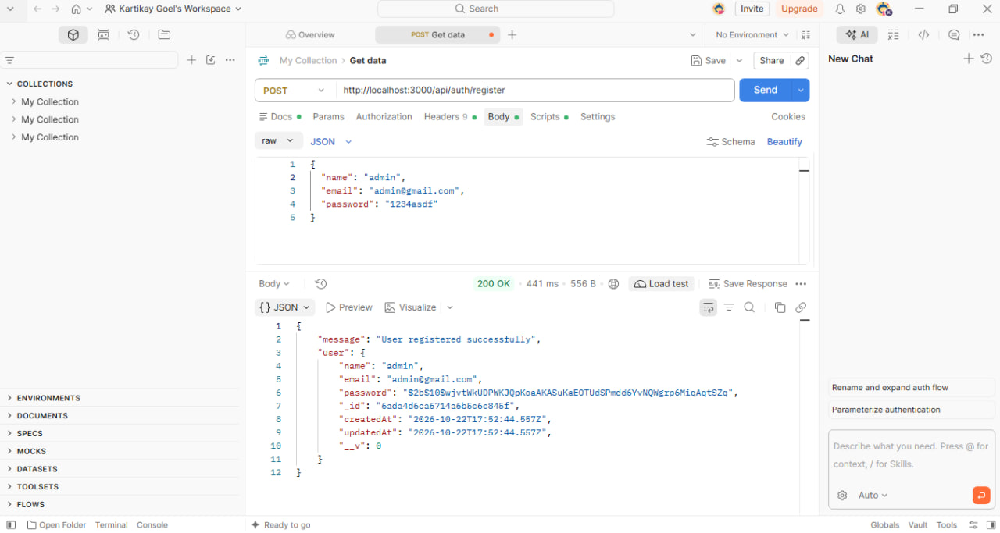
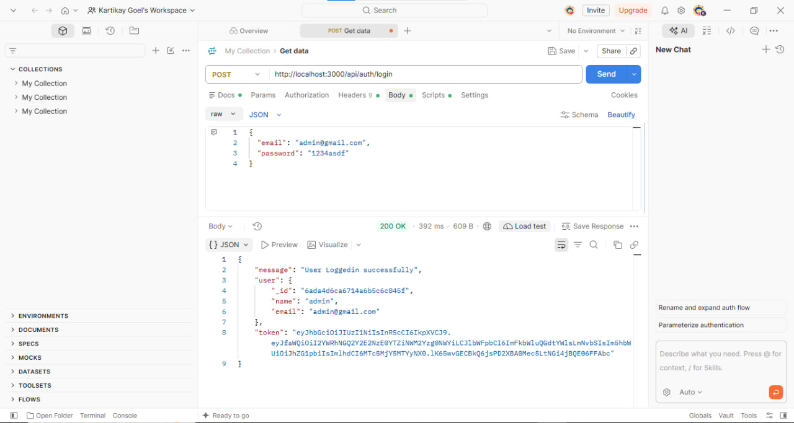
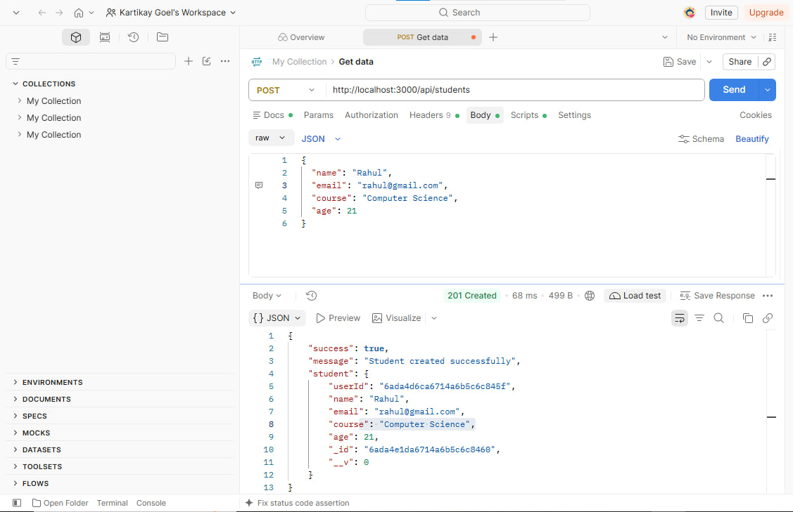
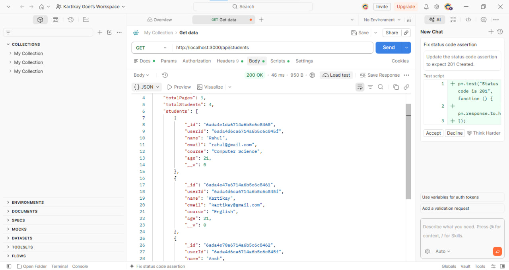
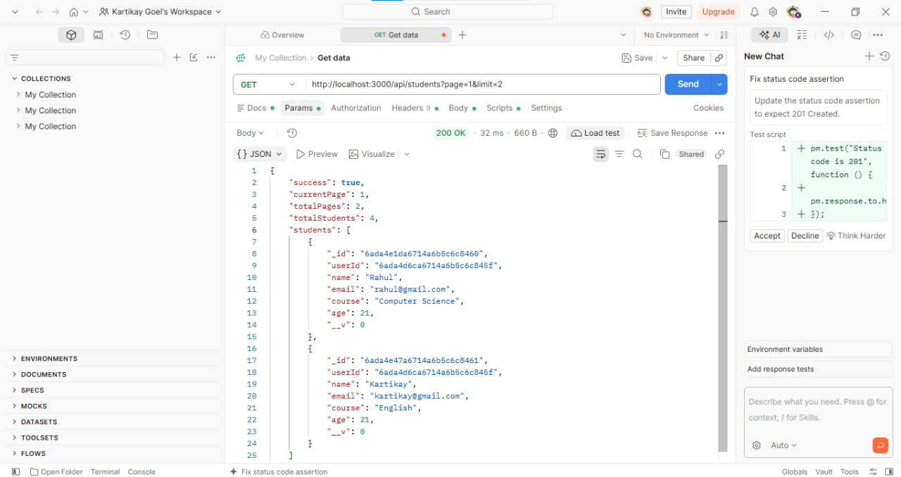
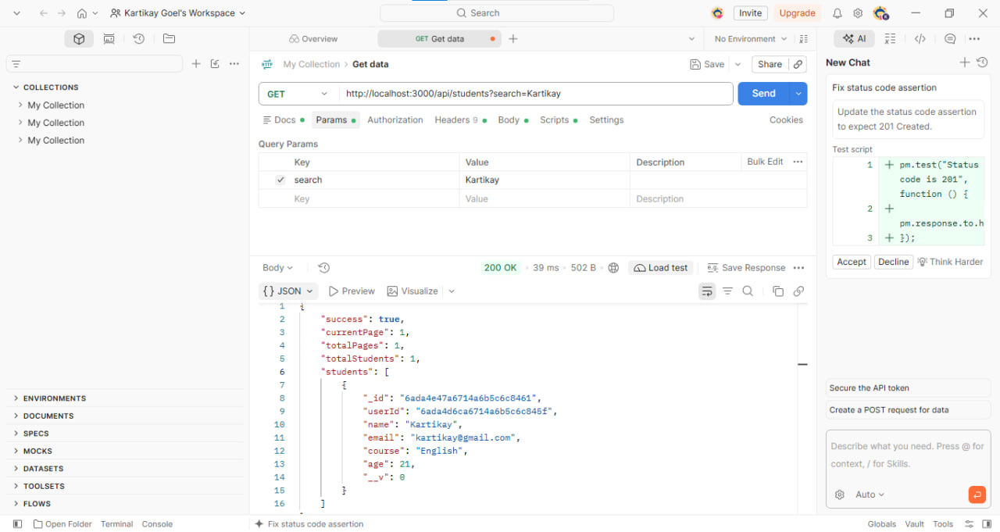
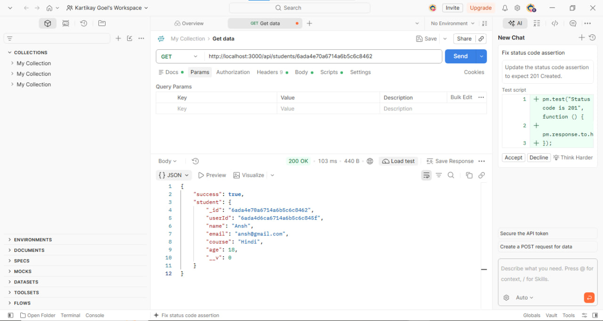
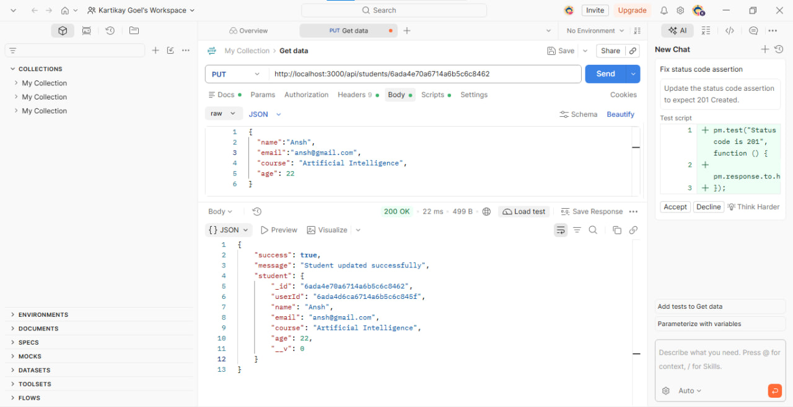
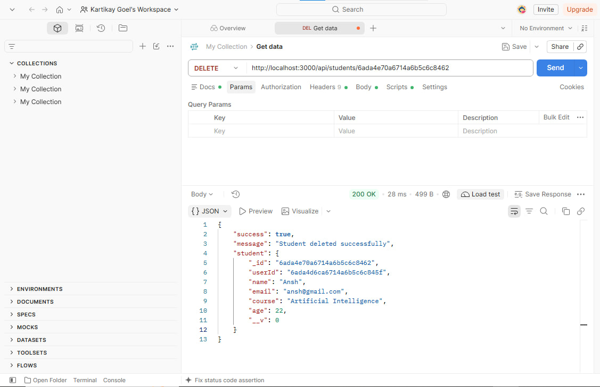

# Student Management CRUD API

A secure and robust backend Student Management System built with Node.js, Express.js, and MongoDB (Mongoose). It features complete user authentication, JWT-based authorization, full CRUD operations, pagination, and case-insensitive search functionality.

---

## Features

- **User Authentication & Authorization:** Secure User/Admin Registration and Login using bcryptjs and jsonwebtoken (JWT).
- **Protected Routes:** Middleware to secure student endpoints so only authenticated users can perform CRUD operations.
- **Student CRUD Operations:** 
  - `POST /api/students` - Create a new student (linked to the logged-in admin).
  - `GET /api/students` - Retrieve all students (Supports Pagination & Search).
  - `GET /api/students/:id` - Retrieve a specific student by ID.
  - `PUT /api/students/:id` - Update student details by ID.
  - `DELETE /api/students/:id` - Delete a student by ID.
- **Advanced Features:**
  - **Pagination:** Query parameters (`page` & `limit`) to manage large datasets.
  - **Search:** Case-insensitive search by student name using MongoDB `$regex`.
  - **Duplicate Validation:** Prevents duplicate student email registration.

---

## Tech Stack & Dependencies

### Core Frameworks & Database
- **Node.js** - JavaScript runtime environment
- **Express.js (`express`)** - Fast, unopinionated web framework for Node.js
- **MongoDB & Mongoose (`mongoose`)** - NoSQL database and Object Data Modeling (ODM) library

### Authentication & Security
- **JSON Web Token (`jsonwebtoken`)** - For creating and verifying JWT access tokens
- **BcryptJS (`bcryptjs`)** - For hashing passwords securely before storing in DB
- **CORS (`cors`)** - Middleware to enable Cross-Origin Resource Sharing

### Configuration & Utilities
- **Dotenv (`dotenv`)** - Loads environment variables from `.env` file
- **Nodemon (`nodemon`)** - Development utility that automatically restarts the server on code changes

---

## Project Structure

```text
├── config/
│   └── mongodb.js         # Database connection setup
├── controllers/
│   ├── student.controllers.js # Student CRUD, Search & Pagination logic
│   └── user.controllers.js    # User Register & Login logic
├── middlewares/
│   └── authMiddleware.js  # JWT verification middleware
├── models/
│   ├── student.model.js   # Student Mongoose Schema
│   └── user.model.js      # User/Admin Mongoose Schema
├── routes/
│   ├── student.route.js   # Student routes (/api/students)
│   └── user.route.js      # Auth routes (/api/auth)
├── .env                   # Environment variables (Ignored in Git)
├── .gitignore             # Specifies intentionally untracked files
├── index.js               # Main server entry point
├── package.json           # Dependencies and scripts
└── package-lock.json      # Locked versions of dependencies

```

## Getting Started & Installation

### 1. Clone the Repository
```bash
git clone https://github.com/Kartikay-goel/student-management-assignment.git

cd student-management-assignment
```

### 2. Install Dependencies
Run the following command to install all required dependencies using `package.json` and `package-lock.json`:
```bash
npm install
```

### 3. Setup Environment Variables
Create a `.env` file in the root directory of your project and add the following configuration:
```env
PORT=3000
MONGODB_URL=your_mongodb_connection_string_here
JWT_SECRET=your_jwt_secret_key_here
```

### 4. Run the Server
For development mode (using nodemon):
```bash
npm run dev
```

For production mode:
```bash
node index.js
```

## API Endpoints Reference

### Authentication Routes (`/api/auth`)
- `POST /api/auth/register` - Register a new admin/user
- `POST /api/auth/login` - Login and receive a JWT access token

### Student Routes (`/api/students`)
> Protected by JWT Authorization Header

- `POST /api/students` - Create a new student record
- `GET /api/students` - Get all students (Supports query parameters: `?page=1&limit=10&search=name`)
- `GET /api/students/:id` - Get a specific student by ID
- `PUT /api/students/:id` - Update student details by ID
- `DELETE /api/students/:id` - Delete a student by ID


---

## 📸 Postman Testing & API Screenshots

### 1. User Registration (`POST /api/auth/register`)


### 2. User Login & Token Generation (`POST /api/auth/login`)


### 3. Create New Student (`POST /api/students`)


### 4. Get All Students (`GET /api/students`)


### 5. Get Students with Pagination (`GET /api/students?page=1&limit=2`)


### 6. Search Student by Name (`GET /api/students?search=Kartikay`)


### 7. Get Student by ID (`GET /api/students/:id`)


### 8. Update Student by ID (`PUT /api/students/:id`)


### 9. Delete Student by ID (`DELETE /api/students/:id`)


---


## Author
Kartikay Goel